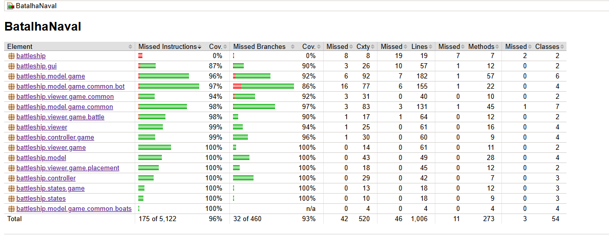
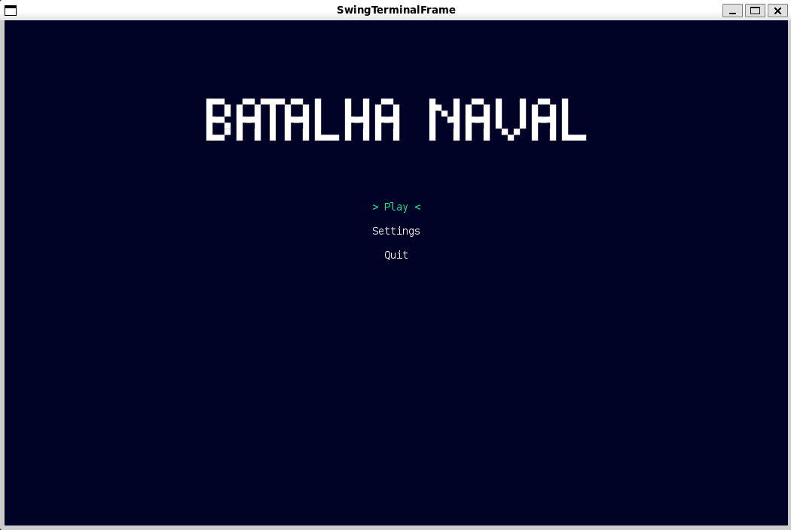
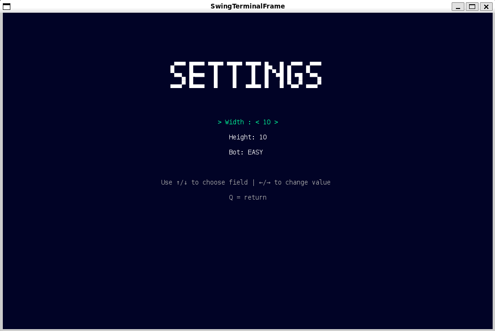
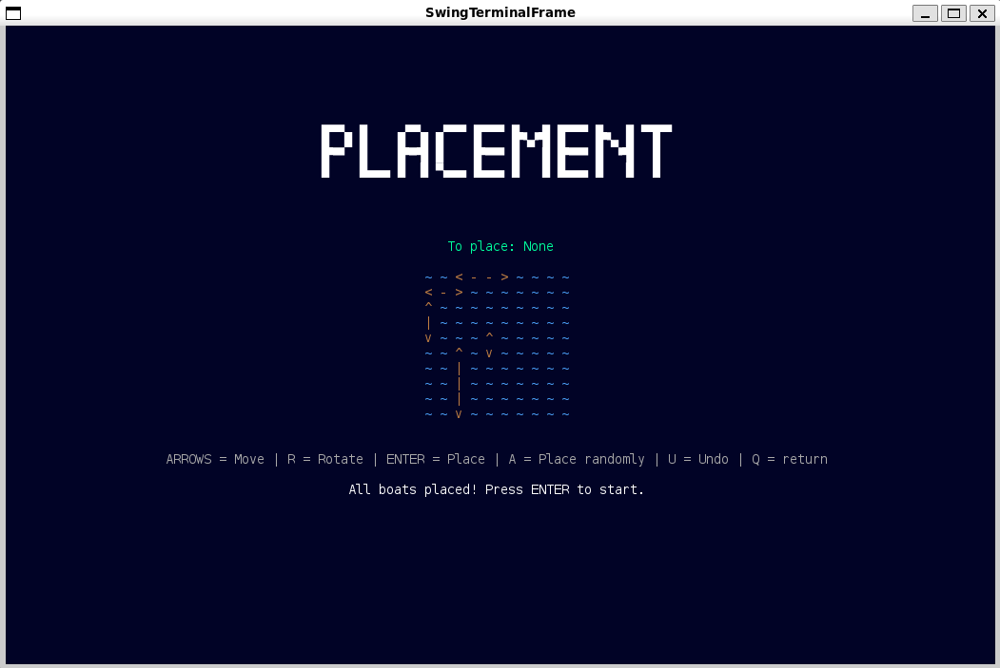
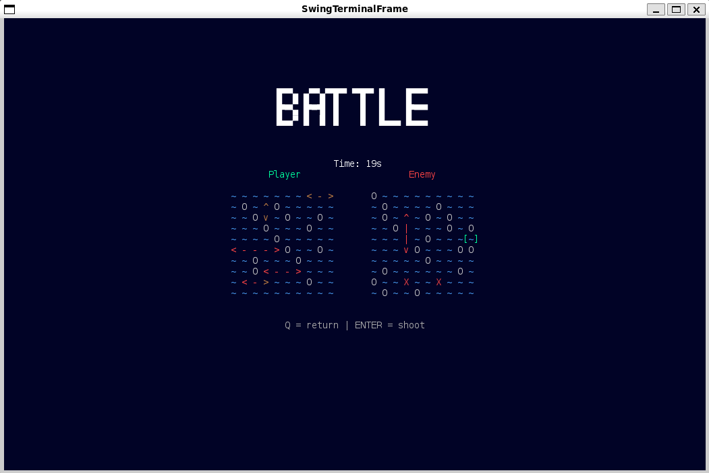
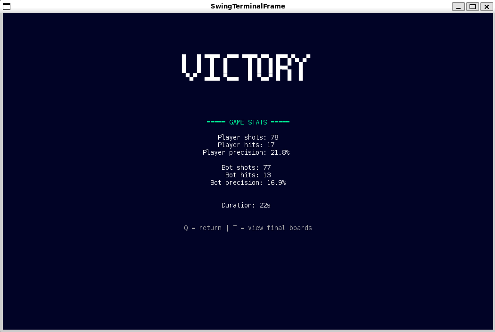
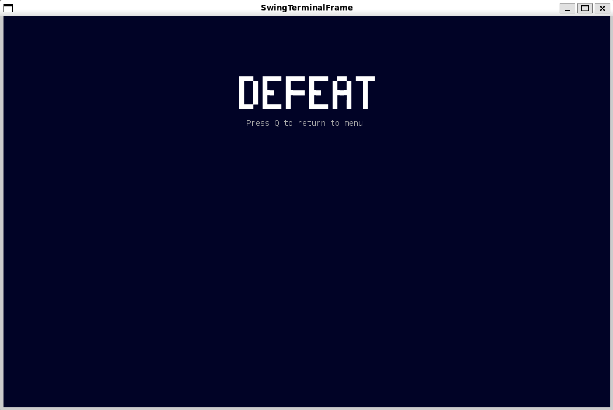
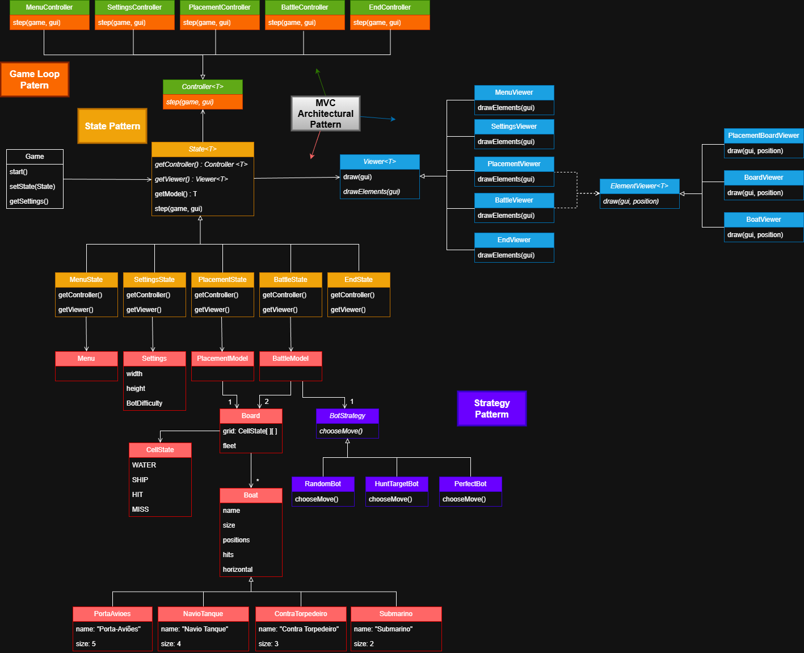

# Batalha Naval
## 1. Descrição do projeto

Este projeto consiste numa implementação em Java do clássico jogo Batalha Naval, jogado inteiramente via terminal através da biblioteca Lanterna.
O jogador posiciona manualmente a frota, roda os navios, escolhe coordenadas de disparo e enfrenta um adversário controlado por bots com diferentes níveis de inteligência.

O objetivo do jogo é afundar todos os navios do inimigo antes que o adversário destrua os do jogador.

## 2. Funcionalidades atualmente implementadas
### Mecânicas base

- Tabuleiro com vários tamanhos possíveis
- Posicionamento manual dos navios com rotação (horizontal/vertical)
- Cursor controlado com as setas 
- Validação de posições e limites no tabuleiro
- Renderização completa do jogo em terminal com Lanterna

### Jogabilidade / Batalha

- Disparo por coordenadas selecionadas com o cursor
- Feedback visual de tiro certo (HIT) e falhado (MISS)
- Derrota/vitória detetada automaticamente

### Bots disponíveis

- Fácil	- RandomBot - Dispara aleatoriamente
- Médio -	HuntTargetBot -	Procura adjacentes depois de um acerto
- Impossível -	PerfectBot -	Acerta todos os tiros

### Interface e Estados

- Menu inicial
- Definições
- Ecrã de colocação da frota
- Ecrã de combate
- Ecrã de fim de jogo

## 3. Desenvolvimento (Decisões e Design)

Durante o desenvolvimento foram identificados vários problemas estruturais que levaram à utilização de padrões específicos.
O objetivo principal foi manter o código limpo, modular e fácil de evoluir.

### Separação entre lógica, interface e input

- **Problema**: renderização, regras e input estavam misturadas → difícil de testar e manter

- **Solução**: MVC

- **Consequência**: Model independente, Viewers focados em desenho, Controllers controlam fluxo → fácil testar e trocar interface futuramente

### Jogo dividido em fases distintas

- **Problema**: cada fase tem lógica diferente → sem separação surgem ifs gigantes

- **Solução**: State Pattern

- **Consequência**: adicionar ou alterar estados do jogo sem modificar a estrutura principal

### Diferentes Bots com estratégias diferentes

- **Problema**: troca de bot exigia alterar o motor do jogo

- **Solução**: Strategy Pattern nos bots

- **Consequência**: novos bots são plug-ins → basta implementar chooseMove()

### Resultado 
- Código modular, extensível e altamente testável.

## 4. Documentação e Testes

A cobertura atual inclui models, controllers e viewers, garantindo o correto funcionamento do jogo.
- Ferramentas usadas:
  - JUnit 5
  - Mockito
  - Jqwik
  - Jacoco (Coverage > 90%)

## 5. Imagens do jogo
### Menu

### Settings

### Placement

### Battle

### Victory

### Defeat

## 6. UML
