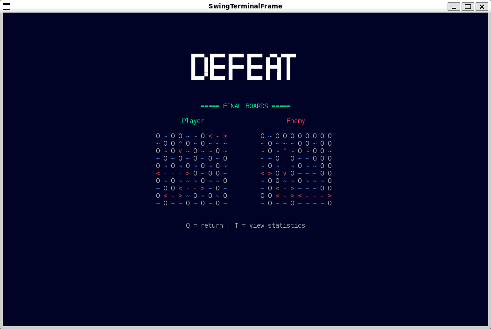

# LDTS_Group_0607 – Battleship

This project is a terminal-based implementation of the classic **Battleship** game, developed for the LDTS course.  
The player can configure game settings, place ships, and play a full match against different AI-controlled bots with increasing difficulty.

The game is structured using well-known design patterns and follows a clear separation between model, view, and controller components.

---

## Main Features

- Configurable board size and bot difficulty
- Manual and automatic fleet placement
- Multiple AI bot strategies:
    - Random (Easy)
    - Hunt (Medium)
    - Probability (Hard)
    - Perfect (Impossible)
- Turn-based battle system
- End game statistics and board visualization

---

## Screenshots

### Menu

### Settings

### Fleet Placement

### Battle Screen

### End Game Screen
- #### Victory

- #### Defeat

- #### Final Boards

